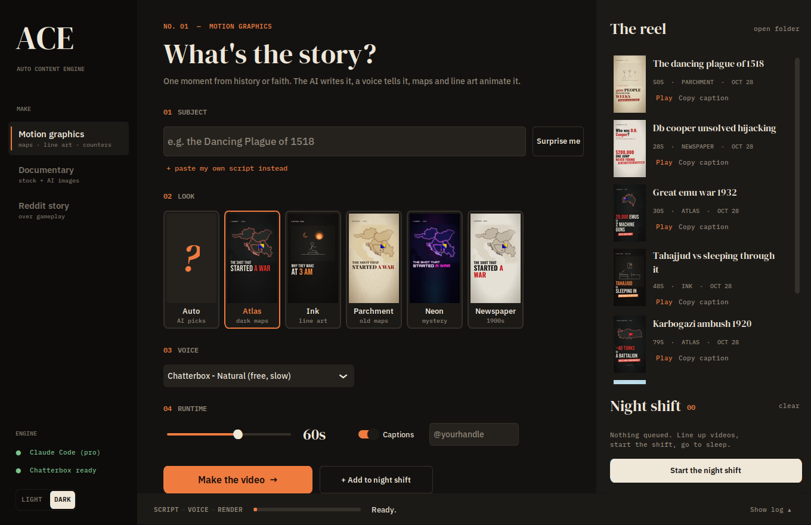
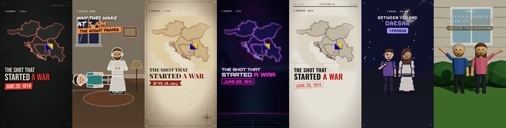
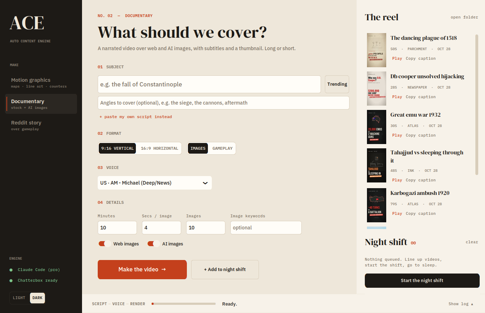

# ACE · Auto Content Engine

Make TikToks, Shorts and YouTube videos from one line of text. Type a subject, for example *"the Dancing Plague of 1518"*, and ACE writes the script, records the voice, animates it and renders a finished MP4 with captions and a ready-to-post description.

It runs on your own computer. If you have **Claude Code** it uses your Claude subscription with no API key needed. The English voices are free and run locally; other languages use free online voices.



---

## What it makes

| Mode | What you get |
| :--- | :--- |
| **Motion graphics** | Animated 9:16 explainers drawn with code: glowing maps with flags and arrows, line-art illustrations, counters, timelines, quotes and "versus" stat battles, with word-by-word captions. Made for history and religion content. |
| **Documentary** | A narrated video over web and AI images (Ken Burns), with subtitles and a thumbnail. Vertical or horizontal, short or long. |
| **Custom Film** | A 3D cartoon written as new code for each video by Claude Code: its own set, cast, camera and acting, in a warm clay-like look. Takes about 35 minutes and needs Claude Code. |
| **Reddit story** | A top Reddit story read aloud over gameplay footage, with bold subtitles. |

### Motion graphics styles



**Atlas** (dark glowing maps) · **Ink** (hand-drawn cartoon people) · **Parchment** (old map on paper) · **Neon** (synthwave, for mysteries and tech) · **Newspaper** (1900s front page) · **Pixel** (8-bit pixel-art people) · **Diorama** (low-poly 3D people in little 3D sets). On **Auto**, the AI picks the style that fits the topic.

The AI combines these scene types: cast (people acting out the moment in a set: they wave, walk, sit, sleep, pray, point, fight and more, dressed for their time and place), map (country or region zoom, flags, markers, arrows), title card, counter, line-art illustration, with/without comparison, timeline, quote and versus.

Each style has its own moving background, scene transition, text animation and caption highlight, and text is measured as it renders so it shrinks to fit instead of overflowing.

Diorama renders in real 3D, so it is the slowest style: about 14 minutes for a 60-second video on a CPU.

---

## How it works

```
Motion graphics:  subject ➔ AI storyboard (scenes as JSON) ➔ voice + word timings ➔ Remotion (React) ➔ 1080x1920 MP4
Documentary:      subject ➔ AI script ➔ web / AI images ➔ Kokoro voice ➔ subtitles ➔ MoviePy + FFmpeg ➔ MP4
Reddit story:     subreddit ➔ top story ➔ Kokoro voice ➔ subtitles ➔ gameplay background ➔ MP4
```

**The AI is picked automatically:**
1. **Claude Code**: if `claude` is installed and logged in, ACE runs it in headless mode on your subscription.
2. **Gemini**: otherwise it uses `GEMINI_API_KEY` from `.env`.

The app's sidebar shows which one is active.

**Voices:**
- **Kokoro**: fast, many accents, always installed.
- **Chatterbox**: much more natural and still free. It is slower (about 10 seconds of work per second of speech on a CPU), so it suits overnight queues. Captions stay in sync because faster-whisper times each word.
- **Edge**: Microsoft's neural voices through `edge-tts`, for every language other than English. Free and fast, but they need internet while recording.

**Languages:** English, Arabic, Chinese, Dutch, French, German, Hindi, Indonesian, Italian, Japanese, Korean, Polish, Portuguese, Romanian, Russian, Spanish, Turkish and Ukrainian. Motion and Documentary videos are written, voiced and captioned in the language you pick, and Arabic videos are laid out right to left. Kokoro and Chatterbox stay English-only, and Reddit stories are read in English as posted.

---

## Setup

### Windows: use ACE.exe

Download `ACE.exe` from the [latest release](https://github.com/Ahmad1827/auto-content-engine/releases/latest) and run it. ACE runs inside WSL, so the first launch sets up WSL if it's missing (this needs a restart), then installs ACE and everything it needs into `~/auto-content-engine` in Ubuntu. That takes several minutes and a few GB, and later launches open straight away. Windows may warn about an unrecognised app, because the file isn't code-signed: choose **More info**, then **Run anyway**.

You still need to set up the AI (step 3), from inside Ubuntu.

### Manual setup

Everything is tested on **WSL2 (Ubuntu) with Python 3.12**. A GPU is not needed.

### 1. System packages

    sudo apt update
    sudo apt install ffmpeg espeak-ng python3.12-venv python3-pip

Motion graphics also need **Node.js 20+** (for example via [nvm](https://github.com/nvm-sh/nvm)). The first render installs the packages in `motion/` by itself.

### 2. Python environment

    python3 -m venv wsl_env
    source wsl_env/bin/activate
    pip install --upgrade pip
    pip install -r requirements.txt
    pip install BingImageCreator pytrends

### 3. AI

**Recommended:** install [Claude Code](https://claude.com/claude-code) and log in once with `claude`. Nothing else is needed.

**Or** create a `.env` file in the project folder:

    GEMINI_API_KEY="your_google_ai_studio_key"

### 4. Optional extras

Add these to `.env` if you use the documentary and trends features:

    NEWS_API_KEY="your_newsapi_key"
    EXPLODING_TOPICS_KEY=""
    PEXELS_API_KEY="your_pexels_key"
    BING_COOKIE="your__U_cookie_value"
    BING_SRCH_COOKIE="your_SRCHHPGUSR_cookie_value"

| What | Where |
| :--- | :--- |
| Gameplay background for Reddit videos | `assets/background.mp4` |
| Background music for motion graphics (played quietly) | `assets/music/background.mp3` |

### 5. Fonts for other alphabets (optional)

Motion videos fetch their own fonts. Documentary subtitles and thumbnails use your system's fonts, so in Hindi, Korean or Chinese they need these:

    sudo apt install fonts-noto-core fonts-noto-cjk

### 6. Chatterbox voices (optional)

Chatterbox needs its own PyTorch version, so it lives in a separate environment called `tts_env`. The app finds it automatically.

    python3 -m venv tts_env
    tts_env/bin/pip install chatterbox-tts faster-whisper soundfile

The first use downloads the models (a few GB, one time only).

---

## Using the app

    source wsl_env/bin/activate
    python3 run.py



- **Sidebar:** pick *Motion graphics*, *Documentary* or *Reddit story*. Only that mode's settings are shown.
- **Subject:** type a topic, or:
  - press **Surprise me** to get a fresh history or religion idea from the AI. It skips topics you've already made.
  - press **Trending** (Documentary mode) to choose from trending topics.
  - press **+ paste my own script instead** to use your own words.
- **Look:** click a style card. **Voice:** pick a language, then a voice that speaks it; Chatterbox voices are listed first for English when they're installed. **Runtime:** target length from 20 to 90 seconds, captions on or off, and your `@handle` shown on the video.
- **The reel** on the right lists your finished videos with thumbnails. *Play* opens one; *Copy caption* copies its description and hashtags.
- **Night shift:** press *+ Add to night shift* on as many videos as you like, then press *Start the night shift* and let it run overnight.
- The bottom bar shows each step (Script → Voice → Render) and the log on demand. Switch between light and dark at the bottom left.

The app remembers your mode, style, voice, length and handle in `.ace_settings.json`.

---

## Command line

    python make_motion.py "The Karboğazı ambush of 1920" --style atlas --seconds 60 --voice chatterbox --handle @yourchannel

| Flag | Meaning |
| :--- | :--- |
| `--style` | `auto` (default), `atlas`, `ink`, `parchment`, `neon`, `newspaper`, `pixel`, `diorama`, `film` |
| `--format` | With `--style film`: the kind of story, such as `relatable` (see `make_motion.py --help`) |
| `--seconds` | Target length (default 55) |
| `--language` | `en` (default), `ar`, `de`, `es`, `fr`, `hi`, `id`, `it`, `ja`, `ko`, `nl`, `pl`, `pt`, `ro`, `ru`, `tr`, `uk`, `zh` |
| `--voice` | A Kokoro preset name, `chatterbox`, or an Edge voice from `src/voice_gen/edge_narration.py`; defaults to the language's first voice |
| `--speed` | Kokoro and Edge speaking speed (default 1.1) |
| `--handle` | Shown at the bottom of the video |
| `--no-captions` | Turns off the word-by-word captions |
| `--from-storyboard` | Re-voices and re-renders a saved `.storyboard.json` |

Every motion video writes three files to `output/`:
- `<name>.mp4`: the video
- `<name>.caption.txt`: the TikTok description and hashtags
- `<name>.storyboard.json`: every scene, ready to edit. Fix the narration, a headline or a map marker, then run `--from-storyboard` to render it again.

To preview and tweak the templates live, run `cd motion && npm run studio`.

---

## Settings

| Variable | Effect |
| :--- | :--- |
| `ACE_LLM` | Force `claude` or `gemini` instead of auto-detecting |
| `ACE_CLAUDE_MODEL` | Claude model for Claude Code, e.g. `opus` |
| `ACE_GEMINI_MODEL` | Gemini model (default `gemini-2.5-flash`) |

---

## Project layout

```
run.py                  start the app
make_motion.py          motion graphics from the command line
src/gui/                the app (CustomTkinter) and its theme
src/llm/provider.py     Claude Code / Gemini auto-detection
src/motion_gen/         storyboard, voices (Kokoro + Chatterbox worker), render
src/script_gen/         documentary scripts
src/video_edit/         image fetching, Ken Burns editing, thumbnails
src/voice_gen/          Kokoro and Edge narration, the language list, subtitles
src/shorts_gen/         Reddit stories over gameplay
src/trend_finder/       trending topics
motion/                 Remotion project: scenes, themes, captions (React + TypeScript)
motion/src/film/        Custom Film kit: characters, acting, sets, lighting, and the brief Claude Code works from
packaging/windows/      source of ACE.exe
assets/fonts, assets/ui bundled fonts (OFL) and style previews
output/                 finished motion videos (not in git)
```

---

## Speed

All timings are on a 4-core CPU without a GPU.

| Step | Time |
| :--- | :--- |
| Storyboard (Claude Code) | ~1 min |
| Kokoro voice, 60 s video | ~30 s |
| Chatterbox voice, 60 s video | ~9 min |
| Render, 60 s video | ~2–3 min |

---

## Troubleshooting

| Problem | Solution |
| :--- | :--- |
| **Sidebar says "No AI found"** | Run `claude` once and log in, or add `GEMINI_API_KEY` to `.env`. |
| **"Chatterbox not installed"** | Create `tts_env` (see Setup step 6). |
| **"Online voice failed"** | Non-English voices need internet while recording; check the connection and try again. |
| **Empty boxes in documentary subtitles or thumbnails** | Install the fonts for that alphabet (see Setup step 5). |
| **Motion render fails on first run** | Check that `node --version` is 20 or newer. The first render runs `npm install` in `motion/`. |
| **numpy/torch build failed** | Use Python 3.12 inside WSL. |
| **espeak-ng / ffmpeg not found** | `sudo apt install ffmpeg espeak-ng` |
| **Exec format error (VS Code)** | WSL interop is off. Edit `/etc/wsl.conf` and add `[interop] enabled=true appendWindowsPath=true`, then run `wsl --shutdown` in PowerShell. |
| **Bing AI failed: redirect failed** | Your Bing cookies (`_U`, `SRCHHPGUSR`) expired. Copy new ones from your browser's dev tools into `.env`. |
| **Gemini 503 UNAVAILABLE** | Google's servers are busy. Wait a minute and try again. |

---

## Credits

[Remotion](https://www.remotion.dev) · [Quaternius](https://quaternius.com) animation libraries (CC0) · [Kokoro-82M](https://huggingface.co/hexgrad/Kokoro-82M) · [Chatterbox](https://github.com/resemble-ai/chatterbox) (Resemble AI, MIT) · [faster-whisper](https://github.com/SYSTRAN/faster-whisper) · [Natural Earth](https://www.naturalearthdata.com) via world-atlas · [flag-icons](https://github.com/lipis/flag-icons) · DM Serif Display and IBM Plex (SIL Open Font License)
